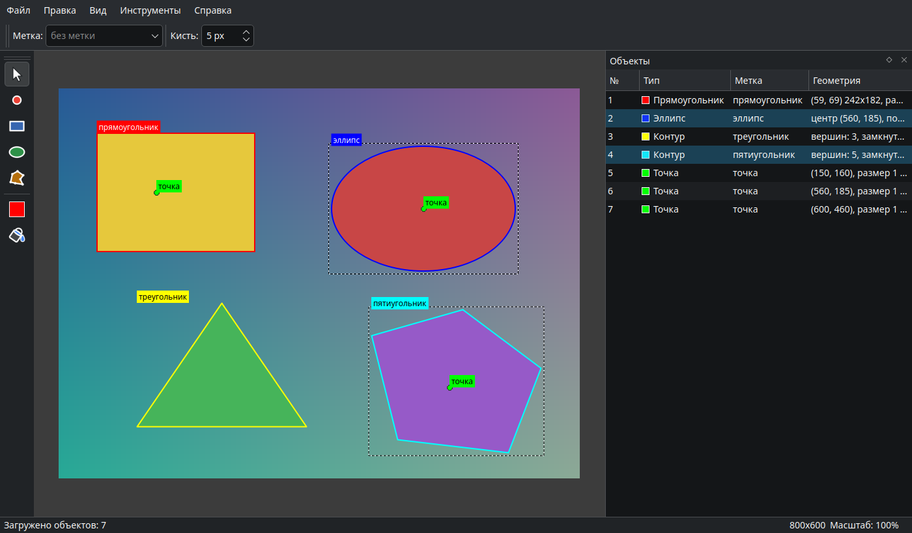
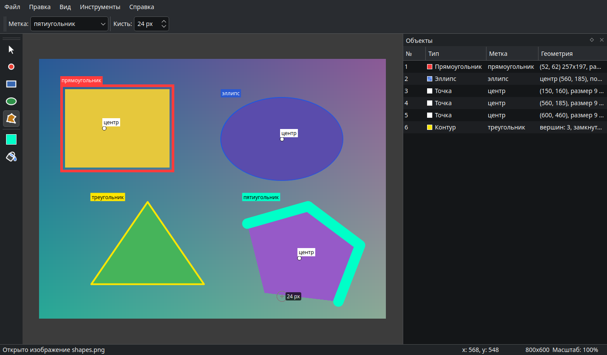
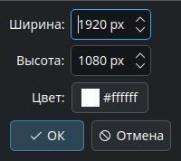

# Image Annotator

Программа для разметки изображений. НИР за 2 курс, тема 9.
Написана на C++17 и Qt 5, собирается через CMake.

На изображении можно отмечать точки, прямоугольники, эллипсы и произвольные контуры, подписывать их метками и сохранять результат в JSON (чтобы потом открыть и продолжить) или в текстовый файл.



Слева панель инструментов, сверху поля «Метка» и «Кисть», справа список объектов. На скриншоте открыт пример `samples/shapes.json`, в списке выделены эллипс и пятиугольник, на холсте они обведены пунктиром. Внизу координаты пикселя под курсором, размер изображения и масштаб.

## Что умеет

- открывать изображение через меню, перетаскиванием в окно или из командной строки;
- создавать пустой холст нужного размера и цвета (Ctrl+N);
- выбирать цвет рисования, в том числе полупрозрачный;
- выделять область прямоугольником, рамкой или с заливкой. Толщина рамки задаётся размером кисти;
- отмечать отдельные точки, размер точки задаётся размером кисти;
- выделять область эллипсом;
- выделять область произвольным контуром: можно обвести мышью с зажатой кнопкой, а можно ставить вершины щелчками;
- подписывать объекты метками, менять метку уже готового объекта;
- выбирать, двигать и удалять объекты, по одному и группой;
- отменять и повторять действия (Ctrl+Z / Ctrl+Y);
- сохранять разметку в JSON и экспортировать в текстовый файл.

## Как размечать

Сначала открывается картинка (Ctrl+O) или файл разметки (Ctrl+Shift+O). Можно просто перетащить файл в окно или передать путь при запуске: по расширению `.json` программа поймёт, что это разметка.

Перед рисованием в поле «Метка» вводится название объекта, например «кот». Новые объекты получают эту метку, пока её не поменяют. Все метки документа попадают в выпадающий список поля, так что второй раз их набирать не нужно. При переходе к следующей картинке метки остаются.

Цвет выбирается кнопкой с квадратом на панели слева. В диалоге есть прозрачность: полупрозрачная заливка не закрывает то, что под ней.



Здесь на той же картинке нарисованы прямоугольник с рамкой 6 px, полупрозрачный залитый эллипс, три точки размером 9 px и два контура. Треугольник уже готов, а пятиугольник обводится щелчками и ещё не завершён. В этот момент размер кисти меняется правой кнопкой мыши: возле курсора видно новое значение, и толщина незавершённого контура меняется сразу.

Как работают инструменты:

- Точка (P) ставится щелчком. Её размер равен размеру кисти.
- Прямоугольник (R) и эллипс (E) рисуются протягиванием мыши. С Shift получаются квадрат и круг, Esc отменяет фигуру. Если включена заливка (F), фигура залита целиком, иначе рисуется рамка толщиной в размер кисти.
- Контур (C) рисуется двумя способами. Если зажать кнопку и вести мышь, контур повторяет движение руки и заканчивается, когда кнопку отпустили. Если щёлкать, каждый щелчок добавляет вершину, а Enter или двойной щелчок завершают контур. Backspace убирает последнюю вершину. Контур из трёх и больше вершин замыкается, из двух получается отрезок.
- Выбор (V) выделяет объект щелчком. С Ctrl объекты добавляются к выделению или убираются из него. Выделенное можно перетащить мышью или сдвигать стрелками (на 1 px, с Shift на 10 px).

Размер кисти задаётся в поле «Кисть», клавишами [ и ] или как в Photoshop: зажать правую кнопку мыши и вести вправо или влево. Клавишами шаг растёт вместе с кистью: до 10 px по одному, до 50 px по пять, дальше по десять. Максимум 500 px. У залитых фигур рамки нет, поэтому при включённой заливке кисть прямоугольника и эллипса всегда 5 px.

Колесо мыши меняет масштаб, Ctrl+0 вписывает картинку в окно, Ctrl+1 показывает в исходном размере. При увеличении пиксели не сглаживаются, чтобы было видно, куда именно попадает граница. Прокручивать можно средней кнопкой или мышью с зажатым пробелом.

## Список объектов

В панели «Объекты» у каждого объекта номер, тип, метка и геометрия (координаты, размеры, число вершин). Выделение в списке и на холсте общее. Несколько строк выделяются протягиванием мыши по списку или щелчками с Shift и Ctrl. Двойной щелчок по строке открывает окно для смены метки, правая кнопка открывает меню с удалением.

Del удаляет все выделенные объекты. Если их было несколько, Ctrl+Z вернёт их одним действием. Перемещение группы тоже отменяется одним шагом.

## Пустой холст



Ctrl+N создаёт пустой холст. Задаются ширина и высота (до 8000 px) и цвет фона. Последние введённые значения запоминаются. На холсте работают те же инструменты, а в JSON вместо пути к картинке сохраняется цвет фона.

## Сборка и запуск

```bash
sudo apt install qtbase5-dev qtbase5-dev-tools qttranslations5-l10n cmake g++
cmake -S . -B build
cmake --build build
ctest --test-dir build
./build/image_annotator samples/shapes.json
```

Нужен Qt 5.12 или новее. Можно открыть `CMakeLists.txt` в Qt Creator. Пакет `qttranslations5-l10n` нужен, чтобы стандартные кнопки и диалоги Qt были на русском, без него программа тоже работает. Если собирать под Windows и раскладывать библиотеки через `windeployqt`, перевод ищется ещё и в папке `translations` рядом с exe.

Программа запоминает размер окна, расположение панелей и последнюю открытую папку. При закрытии или открытии другого файла она предлагает сохранить несохранённые изменения.

## Управление

| Клавиша | Действие |
|---|---|
| V | выбор и перемещение объекта, стрелки двигают на 1 px, с Shift на 10 px |
| P | точка |
| R | прямоугольник, с Shift квадрат, Esc отменяет |
| E | эллипс, с Shift круг, Esc отменяет |
| C | контур. Enter или двойной щелчок завершают, Backspace убирает последнюю вершину, Esc отменяет |
| [ и ] | уменьшить и увеличить кисть |
| Правая кнопка + мышь | вправо увеличить кисть, влево уменьшить (для точки, контура, прямоугольника и эллипса) |
| F | включить или выключить заливку прямоугольников и эллипсов |
| Ctrl + щелчок | добавить объект к выделению или убрать из него |
| Del | удалить выделенные объекты |
| Ctrl+Z, Ctrl+Y | отменить, повторить |
| Ctrl+N | новый холст |
| Ctrl+O, Ctrl+Shift+O | открыть изображение, открыть разметку |
| Ctrl+S, Ctrl+Shift+S | сохранить разметку, сохранить как |
| Ctrl+E | экспорт в TXT |
| Колесо мыши | масштаб |
| Ctrl+0, Ctrl+1 | вписать в окно, исходный размер |
| Пробел + мышь, средняя кнопка | прокрутка |
| F1 | окно со списком клавиш |

## Устройство проекта

```
src/model     классы объектов разметки и документ
src/io        сохранение в JSON и экспорт в TXT
src/tools     инструменты рисования
src/commands  команды для отмены и повтора
src/ui        главное окно, область просмотра, список объектов
tests         тесты на Qt Test
samples       пример картинки и разметки к ней
documents     отчёт по НИР
screenshots   скриншоты для этого файла
```

От базового класса `Annotation` наследуются `PointAnnotation`, `RectAnnotation`, `EllipseAnnotation` и `ContourAnnotation`. Прямоугольник и эллипс наследуются через промежуточный класс `FillableAnnotation`, потому что только их можно заливать. Общие поля (id, метку, цвет) сохраняет базовый класс, а геометрию дописывает каждый наследник. Объекты нужного типа при загрузке создаёт `AnnotationFactory` по полю `type`.

`AnnotationDocument` хранит объекты и список меток и сообщает сигналами, что объект добавлен, изменён или удалён. Список справа и холст подписаны на эти сигналы и обновляют только изменившиеся элементы.

Инструменты сделаны отдельными классами с общим предком `Tool`. Область просмотра просто передаёт текущему инструменту события мыши, а он уже решает, что рисовать. Пока объект рисуется, он существует как черновик и в документ не попадает. Когда фигура готова, она добавляется командой из `src/commands`, и поэтому её можно отменить. Так же через команды сделаны удаление, перемещение и смена метки, все они лежат в одном `QUndoStack`.

Модель и сохранение вынесены в отдельную библиотеку `annotator_core`, которая не зависит от виджетов. Поэтому тесты запускаются без графического окна.

## Тесты

Тесты написаны на Qt Test и запускаются через `ctest --test-dir build`.

`tst_annotations` проверяет попадание мышью в объекты (с учётом толщины рамки и заливки), нормализацию прямоугольника, редактирование контура, сдвиг и копирование объектов, выдачу уникальных id и работу документа с метками.

`tst_rasterize` проверяет растеризацию линий по Брезенхэму: отрезки в разных направлениях, отсутствие повторяющихся пикселей на стыках, замкнутые контуры.

`tst_serialization` сохраняет и загружает объекты и целые документы, в том числе пустой холст, проверяет значения по умолчанию для старых файлов без `width`, отказ на испорченных данных и содержимое TXT-экспорта.

## Форматы файлов

Координаты везде в пикселях исходного изображения, начало в левом верхнем углу.

### JSON

Основной формат: его можно открыть обратно и продолжить разметку.

```json
{
  "format": "image-annotator",
  "version": 1,
  "image": "shapes.png",
  "width": 800,
  "height": 600,
  "labels": ["кот", "мяч"],
  "annotations": [
    {"id": 1, "type": "point", "label": "глаз", "color": "#00ff00", "x": 120, "y": 45, "size": 5},
    {"id": 2, "type": "rect", "label": "кот", "color": "#ff0000", "filled": false, "width": 3, "x": 10, "y": 20, "w": 200, "h": 150},
    {"id": 3, "type": "ellipse", "label": "мяч", "color": "#800000ff", "filled": true, "width": 1, "cx": 400, "cy": 300, "rx": 50, "ry": 30},
    {"id": 4, "type": "contour", "label": "дерево", "color": "#ffaa00", "closed": true, "width": 5, "vertices": [[100,100],[150,90],[160,140]]}
  ]
}
```

Путь к картинке записывается относительно файла разметки, поэтому папку с картинкой и разметкой можно переносить целиком. Если картинка не нашлась, программа попросит указать её вручную, а если у найденной картинки другой размер, предупредит об этом.

Если разметка сделана на пустом холсте, вместо `image` пишется `"canvas": "#ffffff"`, и при открытии холст создаётся заново. У контура `width` означает размер кисти в пикселях, у прямоугольника и эллипса толщину рамки, а `size` у точки её диаметр. Рамка проходит посередине границы фигуры, у залитой фигуры толщина не используется. Если `width` или `size` нет, они считаются равными 1. Цвет хранится как `#rrggbb`, а если есть прозрачность, то как `#aarrggbb`.

### TXT

Экспорт для чтения человеком, обратно он не загружается. В начале файла указаны картинка, её размер и число объектов, дальше у каждого объекта свой блок с подписанными полями. Точки записаны как (x, y). У контура перечислены вершины и все пиксели его средней линии по порядку обхода, по 8 в строке (пиксели получаются алгоритмом Брезенхэма). Если в метке был перевод строки, он заменяется пробелом.

```
Разметка изображения (Image Annotator)
Изображение: shapes.png
Размер: 800 x 600 пикселей
Объектов: 4

Координаты даны в пикселях изображения: x растёт вправо, y вниз,
точка (0, 0) в левом верхнем углу. Рамка фигуры проходит посередине
её границы. У контура перечислены вершины и все пиксели его средней
линии по порядку обхода.

Объект №1. Точка
  Метка: глаз
  Цвет: #00ff00
  Пиксель: (120, 45)
  Размер: 5 px

Объект №2. Прямоугольник
  Метка: кот
  Цвет: #ff0000
  Вид: рамка толщиной 3 px
  Левый верхний угол (10, 20), ширина 200, высота 150
  Вершины по часовой стрелке от левой верхней:
    (10, 20)  (210, 20)  (210, 170)  (10, 170)

Объект №3. Эллипс
  Метка: мяч
  Цвет: #0000ff, непрозрачность 50%
  Вид: сплошная заливка
  Центр: (400, 300)
  Полуоси: по горизонтали 50, по вертикали 30

Объект №4. Контур
  Метка: дерево
  Цвет: #ffaa00
  Вид: замкнутый контур, толщина кисти 5 px
  Вершин: 3
    (100, 100)  (150, 90)  (160, 140)
  Пикселей средней линии по порядку: 160
    (100, 100)  (101, 100)  (102, 100)  ...
```
